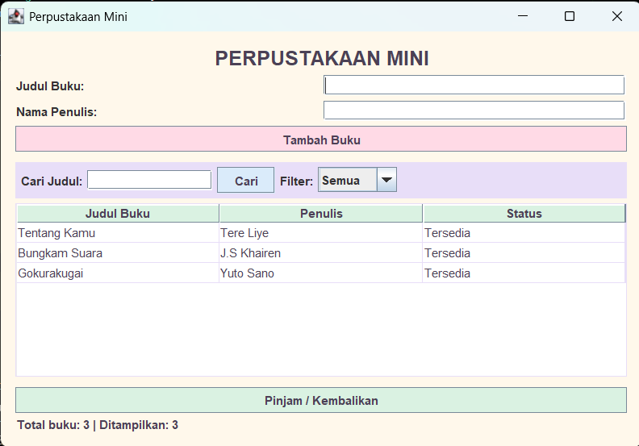
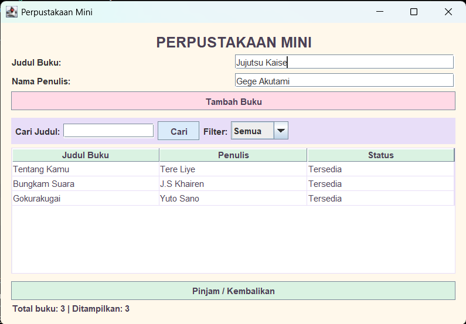
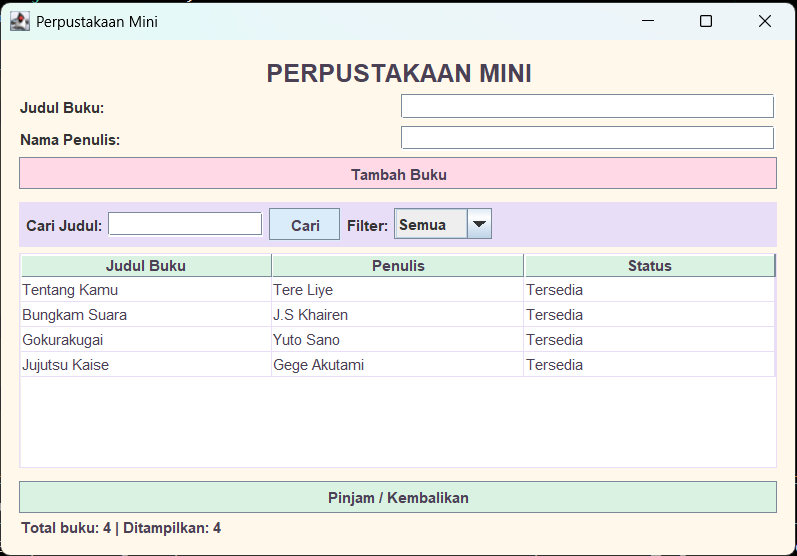
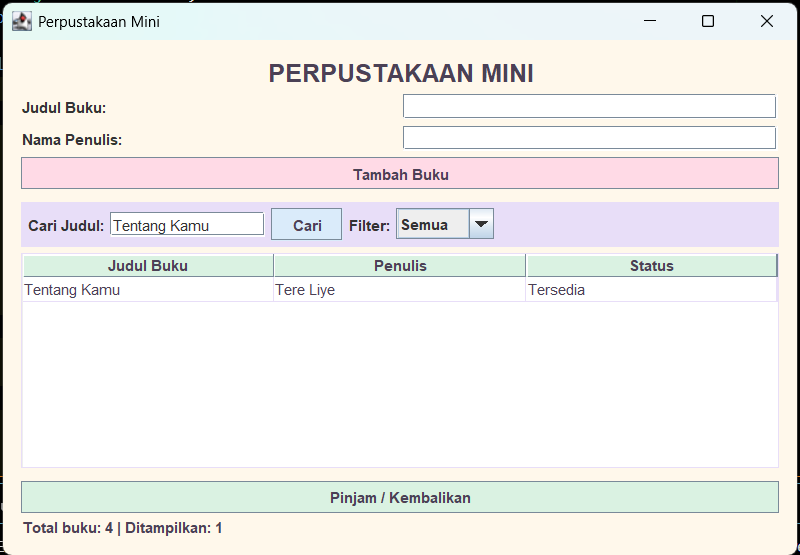
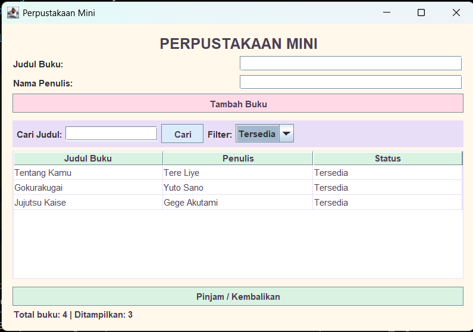
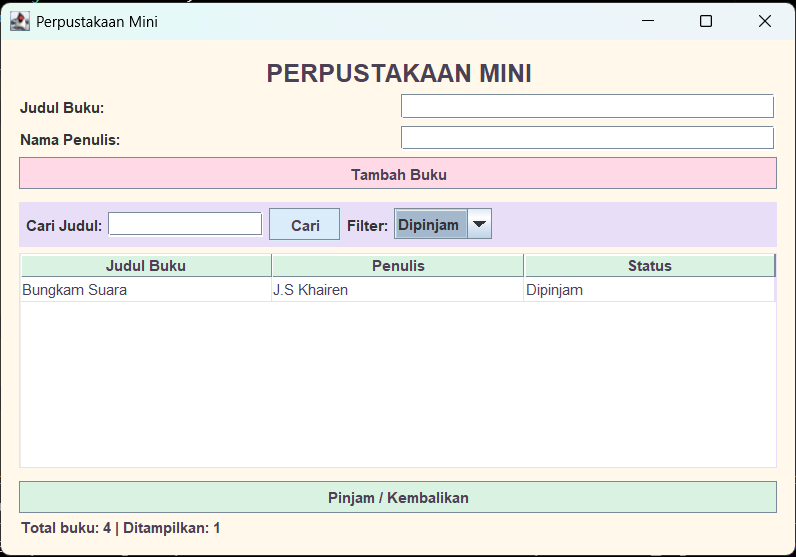
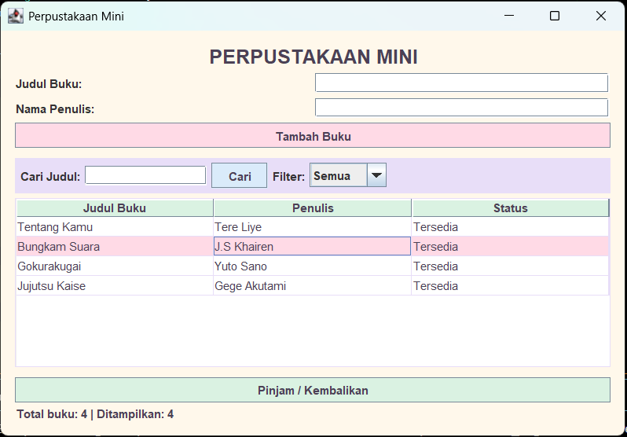
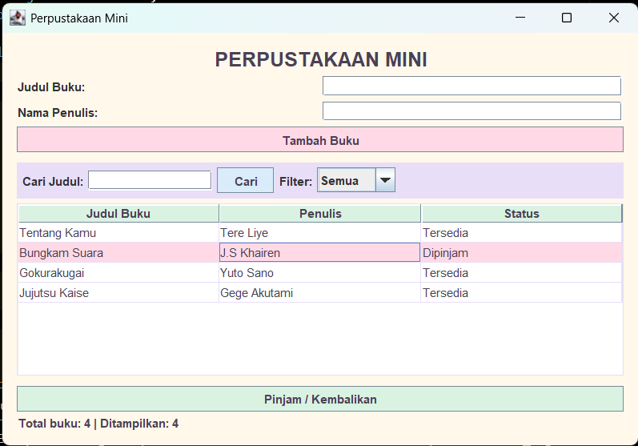

# 📚 Perpustakaan Mini by: Annisa Makarima Ahlaq (F1D02410106)

## Deskripsi

**Perpustakaan Mini** adalah aplikasi desktop sederhana berbasis Java yang dibuat menggunakan Java Swing. Aplikasi ini digunakan untuk mengelola daftar buku, melakukan pencarian berdasarkan judul, memfilter buku berdasarkan status, serta mengubah status buku menjadi tersedia atau dipinjam.

Aplikasi ini memiliki antarmuka grafis (GUI) dengan kombinasi warna pastel agar tampilan lebih menarik dan mudah digunakan. Program ini dikembangkan sebagai penerapan materi Pemrograman Berorientasi Objek (PBO), khususnya penggunaan komponen GUI, Layout Manager, dan Event Handling pada Java.

## ✨ Fitur Aplikasi

- **Tambah Buku** — Menambahkan buku baru dengan memasukkan judul buku dan nama penulis.
- **Pencarian Buku** — Mencari buku berdasarkan judul.
- **Filter Status Buku** — Menampilkan semua buku, buku yang tersedia, atau buku yang sedang dipinjam.
- **Pinjam Buku** — Mengubah status buku dari tersedia menjadi dipinjam.
- **Kembalikan Buku** — Mengubah status buku dari dipinjam menjadi tersedia.
- **Informasi Jumlah Buku** — Menampilkan jumlah seluruh buku dan jumlah buku yang sedang ditampilkan.
- **Tema Pastel** — Menggunakan kombinasi warna cream, pink, lavender, mint, dan baby blue.

## 🖥️ Dokumentasi Tampilan

### 1. Dashboard Aplikasi

### 2. Menambahkan Buku

### 3. Tampilan Setelah Buku Ditambahkan

### 4. Pencarian Buku

### 5. Filter Semua Buku

### 6. Filter Buku Tersedia

### 7. Filter Buku Dipinjam

### 8. Status Buku Tersedia

### 9. Status Buku Dipinjam

## 🧩 Komponen GUI yang Digunakan

| Komponen | Fungsi |
|---|---|
| `JFrame` | Membuat jendela utama aplikasi. |
| `JPanel` | Mengelompokkan dan menyusun komponen GUI. |
| `JLabel` | Menampilkan judul, label input, dan informasi jumlah buku. |
| `JTextField` | Menerima input judul buku, nama penulis, dan kata kunci pencarian. |
| `JButton` | Menjalankan aksi tambah, cari, pinjam, dan kembalikan buku. |
| `JComboBox` | Memilih filter status buku. |
| `JTable` | Menampilkan daftar buku, penulis, dan statusnya. |
| `JScrollPane` | Menyediakan area yang dapat digulir pada tabel. |
| `DefaultTableModel` | Mengelola data yang ditampilkan pada tabel. |
| `BorderFactory` | Mengatur margin dan garis tepi komponen. |